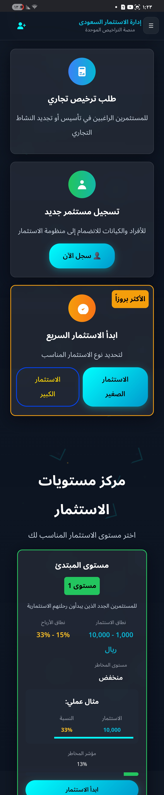

# منصة إدارة الاستثمار والتراخيص السعودية

**Saudi Investment & Licensing Platform**

منصة ويب عربية لإدارة تجربة المستثمر وطلبات التراخيص والاستثمارات من خلال واجهة موحدة. يقدّم هذا المستودع المشروع بوصفه عملًا في معرض الأعمال، مع لقطات شاشة توضح الواجهة وتجربة الاستخدام.

## نبذة عن المشروع

تركّز المنصة على تسهيل رحلة المستثمر، بدءًا من استعراض مستويات الاستثمار وتقديم الطلبات، وصولًا إلى متابعة الحساب والاستثمارات والتراخيص. كما تتضمن واجهات إدارية لمتابعة المستثمرين والطلبات والمدفوعات والوثائق والتقارير.

## أبرز الوظائف

- صفحات تعريفية ومستويات استثمار باللغة العربية وبتصميم متوافق مع اتجاه الكتابة من اليمين إلى اليسار (RTL).
- التسجيل وتسجيل الدخول واستعادة كلمة المرور، مع التحقق من البريد الإلكتروني برمز لمرة واحدة (OTP).
- تسجيل المستثمر وإنشاء الحساب عبر Google باستخدام OAuth 2.0 وLaravel Socialite.
- حماية نموذج التسجيل باستخدام Google reCAPTCHA والتحقق من الرمز على الخادم.
- لوحة للمستثمر لمتابعة الاستثمارات والأرباح والتراخيص وطلبات السحب.
- نماذج طلبات التراخيص والاستثمار ورفع المستندات.
- واجهات إدارية لإدارة المستثمرين والاستثمارات والتراخيص والمدفوعات والوثائق.
- صفحات للتقارير ومؤشرات السوق والتواصل.

## التقنيات المستخدمة

- **PHP 8.2+**
- **Laravel 11**
- **Blade** لقوالب وواجهات الويب.
- **Laravel Socialite وGoogle OAuth 2.0** لتسجيل الدخول والتسجيل عبر Google.
- **البريد الإلكتروني وOTP** لإرسال رموز التحقق وتفعيل الحساب واستعادة كلمة المرور.
- **Google reCAPTCHA** للتحقق من التسجيلات وإرسال الرمز إلى خدمة التحقق من Google من جهة الخادم.
- **HTML وCSS وJavaScript** لبناء واجهات الاستخدام.
- **قاعدة بيانات علائقية** عبر طبقة قواعد البيانات في Laravel.

## لقطات من الواجهة

### الصفحة الرئيسية

### تسجيل دخول المستثمر

### خيارات الاستثمار ومستوياته

## ملاحظة حول المستودع

يتضمن هذا المستودع الشيفرة المصدرية وملفات الواجهات والمسارات لأغراض العرض ضمن معرض الأعمال. لا يتضمن ملفات الاعتماد أو ملفات التشغيل الأساسية أو الإعدادات المحلية وقواعد البيانات والملفات المرفوعة؛ لذلك لا يمكن تثبيته وتشغيله مباشرة بالطريقة المعتادة. ملفات الأدوات المحلية غير المخصصة للعرض مستبعدة أيضًا.

